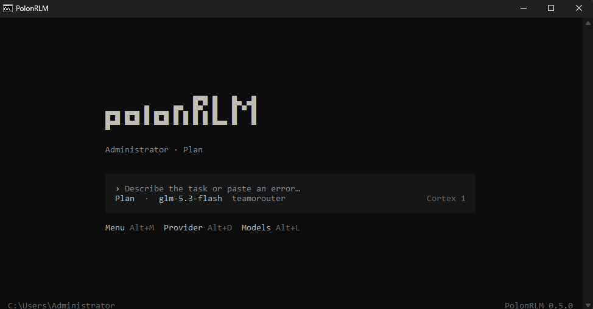

# PolonRLM

A coding agent that runs in your terminal and works in the project you open.

[](https://github.com/Kl3ban/PolonRLM-code/actions/workflows/ci.yml)
[](LICENSE)

<p align="center">
  
</p>

PolonRLM is written in TypeScript and runs on Node.js 24 or newer. It takes inspiration from OpenCode, but has its own code and interface.

## What it does

- Reads and searches project files, checks Git, edits code, and runs commands.
- Uses TypeScript and JavaScript symbol tools, AST tools, and language servers.
- Hands separate tasks to subagents that share the task budget.
- Searches the web, controls a headless browser, connects to MCP servers, and can use the Windows desktop.
- Saves chat history locally and can compact old context without another model call.
- Connects to hosted APIs, local model servers, or a custom OpenAI-compatible endpoint.

The model chooses when to use tools. Writes, shell commands, and other actions follow the permission settings. By default, PolonRLM asks before sensitive actions. Shell commands run with your Windows or terminal account permissions.

## Install

You need Node.js 24 or newer.

```sh
git clone https://github.com/Kl3ban/PolonRLM-code.git
cd PolonRLM-code
npm ci
npm run build
npm link
PolonRLM setup
PolonRLM
```

On Windows, the setup script can install the command for you:

```powershell
powershell -NoProfile -ExecutionPolicy Bypass -File .\scripts\install.ps1
PolonRLM setup
PolonRLM
```

The setup screen helps you choose a provider and model. Enter API keys locally; they are not part of the repository. Windows stores keys encrypted with DPAPI. On other systems, use the environment variable for your provider.

## Providers and models

Built-in providers include Google, OpenAI, Anthropic, OpenRouter, NVIDIA, Mistral, DeepSeek, TeamRouter, Groq, Ollama, LM Studio, and vLLM. You can also add a custom OpenAI-compatible endpoint.

```text
/connect
/key <api-key>
/models
/model <model-id>
```

`/models` shows models listed by the provider. It does not confirm that your account can use every model shown. See [provider notes](docs/PROVIDERS.md).

## Commands

| Command | Use |
| --- | --- |
| `/plan <task>` | Inspect the project and suggest a plan without changing files. |
| `/build <task>` | Work on a task. File changes still follow your permission settings. |
| `/review <task>` | Review code without making edits. |
| `/settings` | Change budgets, browser, model, search, and other options. |
| `/permissions` | View or change which tools can run automatically. |
| `/image <path>` | Attach an image to the next request. The model must support images. |
| `/agents` | See active subagents. |
| `/sessions` | Find saved chats for the current project. |
| `/help` | Show the full command list. |

More commands are in [docs/COMMANDS.md](docs/COMMANDS.md).

## Web and browser tools

Web search uses public search pages and does not need a search API key. Its local helper needs Python 3.11 or newer; setup installs its dependencies when they are needed. Run `PolonRLM setup web` to prepare it in advance.

Browser automation runs headless and does not use your regular browser profile or cookies. Playwright browser builds are downloaded only when first needed. Choose the browser in `/settings`.

## Limits and permissions

Token, cost, call, context, agent, process, and tool-output limits start unlimited in PolonRLM. Set limits in `/settings` or `/budget` if you want them. Your provider still applies its own limits and billing.

The `workspace` permission allows normal changes in the current project. `readonly` blocks writes and shell actions. Read each approval prompt before accepting it; shell commands are not sandboxed.

## Development

```sh
npm ci
npm run check
npm test
npm run build
npm run bench
```

These tests run locally and do not need a model API key. Live tests use a real provider and may use its tokens or credits, so they are separate commands.

## More information

- [Architecture](docs/ARCHITECTURE.md)
- [Commands](docs/COMMANDS.md)
- [Providers](docs/PROVIDERS.md)
- [Tools](docs/TOOLS.md)
- [Local web search](docs/LOCAL-WEB.md)
- [Browser and desktop control](docs/COMPUTER-USE.md)
- [License](LICENSE)

## License

MIT
